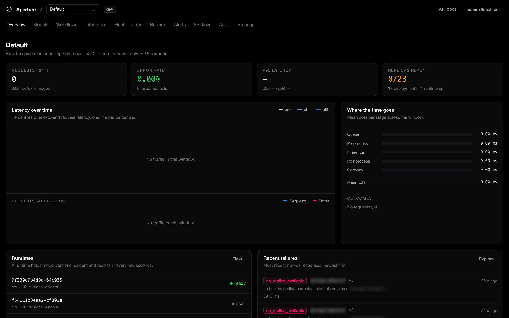
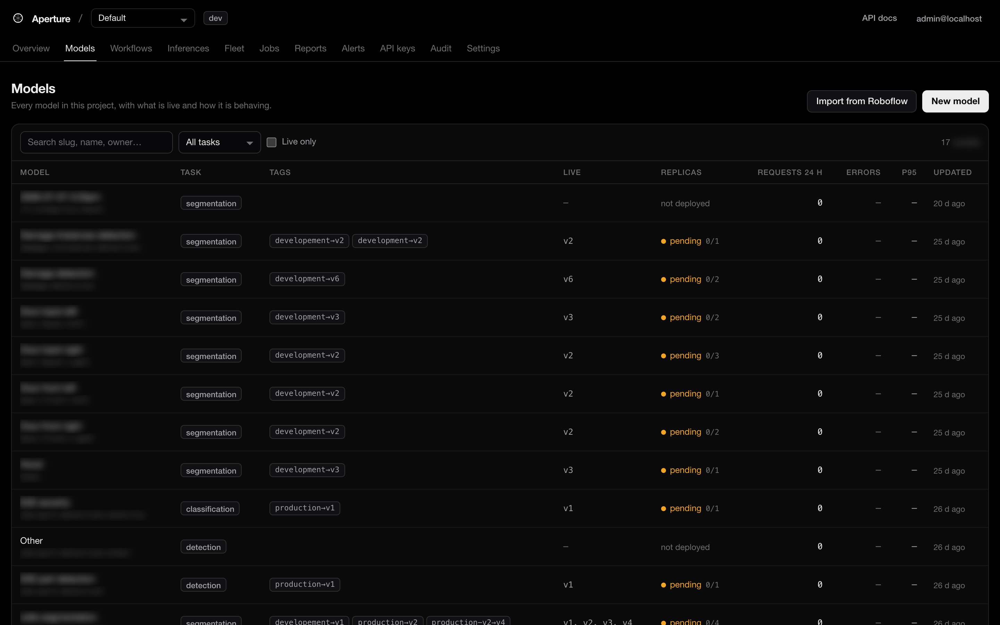
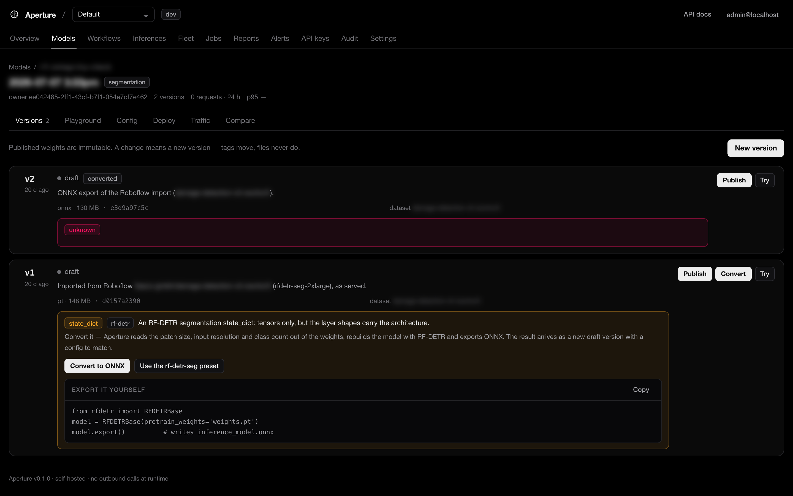
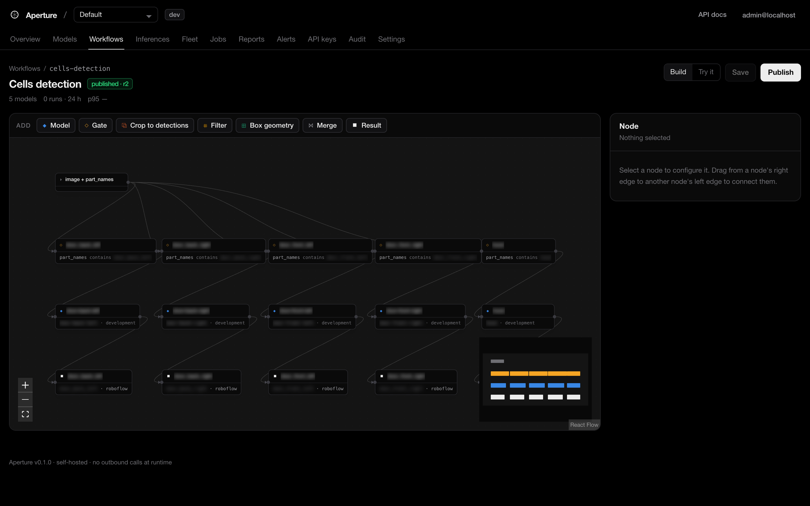
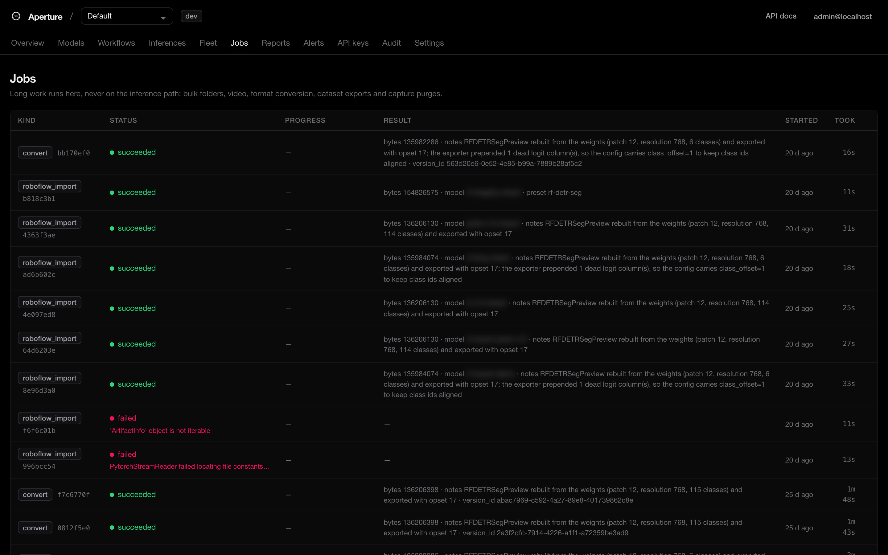
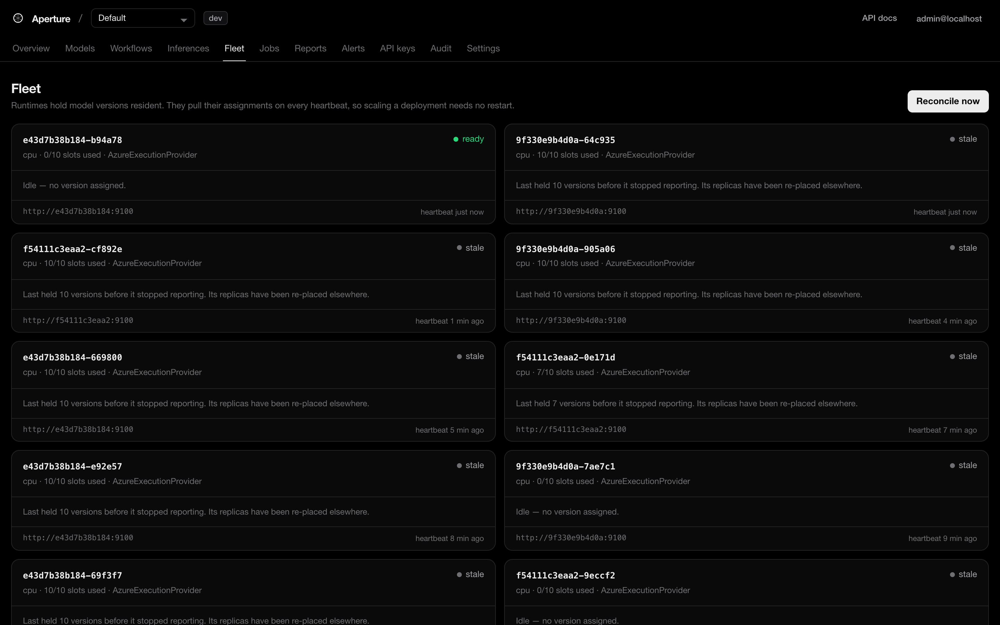
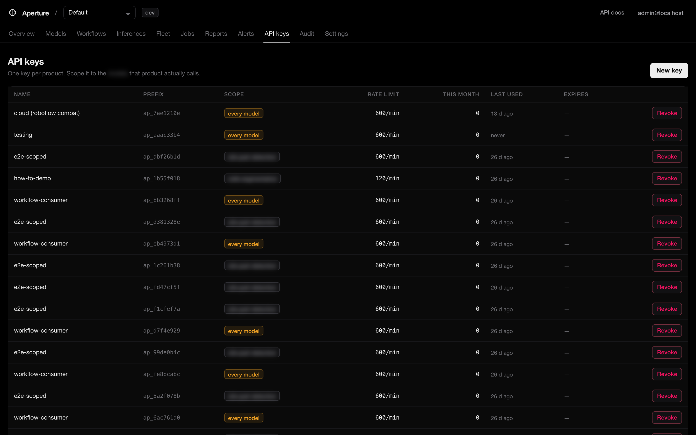
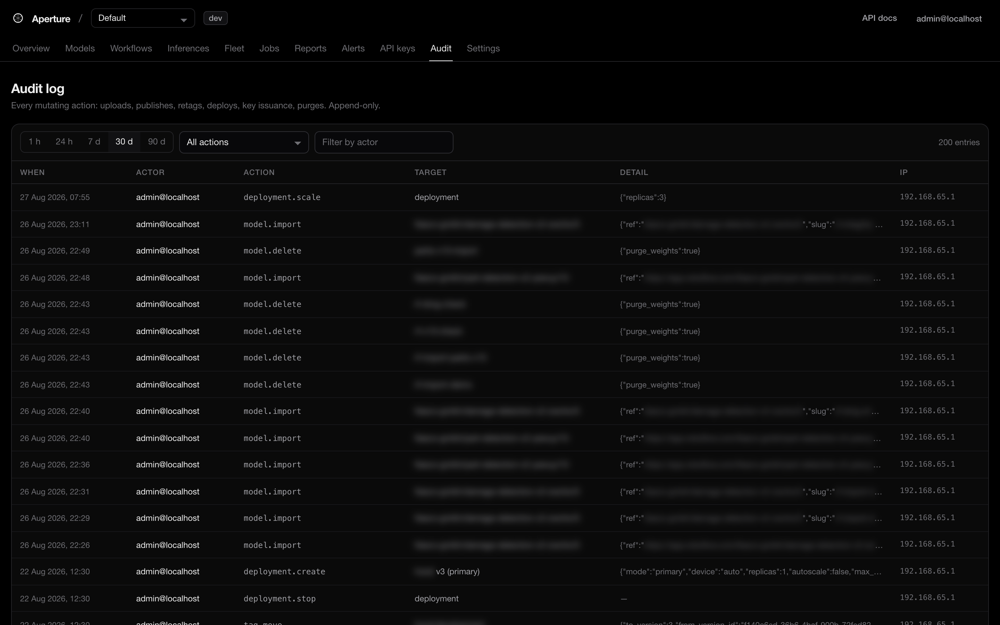

# Aperture

Self-hosted serving, versioning and observability for computer-vision models.
Upload weights, prove the config on a reference image, deploy, and let products
call a stable URL:

```
POST /v1/models/part-detection/production/predict
```

Built for the case where the models come out of Roboflow or a local training
run — YOLO11, RF-DETR, segmentation, classification, OCR, embeddings — and
several products need to call them without each one re-implementing
preprocessing.

```bash
git clone <this repo> && cd aperture
cp .env.example .env          # then change the three CHANGE ME values
make up                       # or: docker compose up -d --build
make seed                     # optional: a demo workspace with traffic in it
open http://localhost:8080    # admin@localhost / aperture
```

`make test` runs the pipeline and runtime suites. `make e2e` drives a running
stack through upload → validate → deploy → predict → retag → roll back and
asserts the guarantees below (65 checks).

---

## A look around

Screenshots from a running instance. Model names are blurred; everything else
is as the console renders it. `landing/` is a one-page React tour built from
the same images (`cd landing && npm install && npm run dev`, or
`docker compose --profile landing up -d landing` for nginx on :8081).



**Models** — every model in the workspace, what is live and how it is behaving.



**Versions** — published weights are immutable. A PyTorch `state_dict` can be
converted to ONNX in place; the result arrives as a new draft version.



**Workflow editor** — several models drawn as one graph and served as one
endpoint. Gates route on request fields, each result lands under its own key.



**Jobs** and **Fleet** — long work off the inference path, and every runtime
with what it holds and when it last reported.





**API keys** and **Audit** — one key per product, scoped to the models it
calls; every mutating action, append-only.





Regenerate with `scripts/screenshots.py` against a running stack.

---

## What it is

Four processes and three stores. Nothing calls out to the internet at runtime.

```
                    ┌──────────────┐
  browser ────────▶ │  web (nginx) │ ── serves the UI, proxies the API
                    └──────┬───────┘
                           │
  products ────────────────┼────────────▶ ┌─────────────────────┐
  (x-api-key)              │              │  api                │
                           └─────────────▶│  registry + gateway │
                                          └──┬───────┬──────┬───┘
                                             │       │      │
                     assignments / heartbeat │       │      │ log stream
                                             ▼       │      ▼
                                    ┌────────────┐   │  ┌─────────┐
                                    │  runtime   │   │  │ logsink │
                                    │  ×N        │   │  └────┬────┘
                                    │  weights   │   │       │
                                    │  resident  │   │       │
                                    └─────┬──────┘   │       │
                                          │          │       │
   postgres  ◀── metadata ────────────────┼──────────┴───────┘
   minio/s3  ◀── weights, captures ───────┘
   redis     ◀── replica registry, tags, rate limits, log stream
                                          ▲
                                    ┌─────┴──────┐
                                    │  worker    │ jobs + cron:
                                    │  (arq)     │ reconcile, autoscale,
                                    └────────────┘ alerts, drift, retention
```

* **api** — the model registry *and* the inference gateway in one process, so
  resolving a tag costs no network hop. Stateless; scale with replicas.
* **runtime** — holds model versions resident on CPU or GPU, batches requests
  across callers, and reports what it is holding every few seconds. This is the
  only process that loads weights.
* **worker** — everything that must not touch inference latency: bulk and video
  jobs, format conversion, dataset exports, plus the cron ticks that reconcile
  the fleet, evaluate alerts, roll up drift windows and expire captures.
* **logsink** — drains the inference-log stream into Postgres. A database hiccup
  degrades observability, not serving.

`ARCHITECTURE.md` covers the request path, the reconciler and the failure modes
in detail. `REQUIREMENTS.md` maps every requirement to where it lives.

---

## The three ideas worth knowing

**Config travels with the version.** Preprocessing, the decoder, thresholds and
the class list are stored on the model *version*, not globally. A retrained
model that needs a different resize mode is a new version, not a coordinated
deploy. Published versions are immutable — the API refuses to edit one.

**Tags resolve per request.** Products call `production`; Aperture resolves it
on every call. Rolling back is repointing a tag: instant, no redeploy, no client
change. Deploying a new version warms it up on its own replicas first, so
traffic only moves once something is ready to answer.

**Validation is a rendered overlay, not a checkmark.** Before a version can be
published, Aperture runs the whole pipeline on a reference image through a real
runtime and stores the overlay. A letterbox that should have been a stretch, a
class list off by one, BGR read as RGB — these look wrong in the overlay and
silent in a status field.

---

## Uploading a model

Through the UI: **Models → New model → New version**. Pick the architecture
family (YOLOv5 / YOLOv8 / YOLO11 / RF-DETR / ResNet / EfficientNet / YOLO-seg /
SAM / pose / CLIP / PaddleOCR-rec), drop the file, add the dataset version and
metrics, upload. Then **Validate**, look at the overlay, **Publish**, **Deploy**,
and point `production` at it.

Through the API:

```bash
# 1. a version, inheriting the previous config (or starting from a preset)
curl -X POST "$AP/v1/models/part-detection/versions" -H "authorization: Bearer $TOKEN" \
  -H 'content-type: application/json' \
  -d '{"preset":"yolov11","dataset_version":"Part-Detection-V2-10",
       "metrics":{"mAP50":0.71},"changelog":"September retrain"}'

# 2. resumable upload (chunks of 32 MB by default; a dropped connection costs one chunk)
curl -X POST "$AP/v1/models/part-detection/versions/3/uploads" -H "authorization: Bearer $TOKEN" \
  -H 'content-type: application/json' \
  -d '{"filename":"best.onnx","total_bytes":48210944,"sha256":"…"}'
curl -X PUT "$AP/v1/uploads/$UPLOAD/parts/1" -H "authorization: Bearer $TOKEN" -F chunk=@part1
curl -X POST "$AP/v1/uploads/$UPLOAD/complete" -H "authorization: Bearer $TOKEN"

# 3. prove it, then ship it
curl -X POST "$AP/v1/models/part-detection/versions/3/validate" -H "authorization: Bearer $TOKEN" \
  -F sample=@reference.jpg
curl -X POST "$AP/v1/models/part-detection/versions/3/publish" -H "authorization: Bearer $TOKEN"
curl -X POST "$AP/v1/models/part-detection/deployments" -H "authorization: Bearer $TOKEN" \
  -H 'content-type: application/json' -d '{"version":3,"replicas":2,"max_batch_size":8}'
curl -X PUT "$AP/v1/models/part-detection/tags" -H "authorization: Bearer $TOKEN" \
  -H 'content-type: application/json' -d '{"name":"production","version":3}'
```

**What Aperture does with the bytes you upload.** A `.pt` is three different
things depending on how it was saved, so the upload is inspected rather than
trusted by extension:

| What it is | What happens |
|---|---|
| **ONNX**, **TorchScript**, **TensorRT engine** | servable — validate it and deploy |
| **Ultralytics checkpoint** (`YOLO(...).save()`) | convertible — one click exports it to ONNX (needs the `convert` profile) |
| **RF-DETR `state_dict`** | convertible — Aperture reads the patch size, resolution and class count out of the layer shapes, rebuilds the model with `rfdetr` and exports ONNX |
| any other **`state_dict`** (weights only) | refused, with the architecture Aperture recognised from the layer names, the preset to start from once it *is* ONNX, and the exact export command |
| **safetensors** | refused for the same reason: tensors, no graph |

A `state_dict` is refused rather than half-supported because *nothing* can
execute one — not even a PyTorch runtime. Only the code that defined the model
can turn it into a graph. Aperture says which architecture it looks like
(`transformer.decoder.*` → RF-DETR, `model.0.conv.*` → YOLO) and hands you the
command:

```python
from rfdetr import RFDETRBase
model = RFDETRBase(pretrain_weights='weights.pt')
model.export()          # writes inference_model.onnx
```

RF-DETR is worth calling out, because a bare `state_dict` normally *is* a dead
end. Its layer shapes carry everything needed to rebuild the architecture, so
Aperture recovers them rather than asking you to remember your training
arguments:

```
patch_size   the patch-embedding convolution's kernel      →  12
resolution   sqrt(position embeddings − 1) × patch_size    →  768
num_classes  the classification head's width, less one     →  114
segmentation whether a mask head is present                →  yes
```

It then picks the matching variant (`RFDETRSegPreview` here), exports ONNX, and
lands it as a new draft **with a config that already matches the graph** — task,
decoder, input resolution and class count. That version validates on the first
try; all you add are the real class names.

One quirk of that export is worth knowing about, because it is invisible until
it bites. The exporter widens the classification head by one column and puts the
new one *first*: zero weights, bias −20, so it can never fire. Read as-is it
shifts every class id up by one — harmless while the names are placeholders,
silently wrong once the real ones are in. Aperture measures the export against
the checkpoint's head width, and writes `postprocess.class_offset` into the
generated config when the leading column is genuinely dead, so ids match what
`rfdetr.predict` reports for the same weights.

**ONNX is an option, not a toll gate.** A `.pt` that carries a graph — a
TorchScript archive, a pickled module, an Ultralytics checkpoint — is served as
it is by a runtime that has torch:

```bash
docker compose --profile torch up -d runtime-torch
```

Runtimes advertise the artifact formats their image can load, and placement reads
that: a `.pt` version is assigned to a torch runtime, an ONNX version to any
replica. Nothing to configure, and a slim ONNX-only replica is never handed a file
it cannot open. Verified on a YOLO-seg checkpoint: the eager torch path and the
ONNX export of the same weights return identical scores, identical boxes and
identical mask areas, because an Ultralytics forward emits the same tensors its
export does and the same decoder config reads both.

So converting is a *choice* — a smaller artifact with no torch dependency, usually
faster — and the only time it happens on its own is when no runtime in the fleet
can load the file at all, because then the upload is a dead end rather than a
trade-off. Conversion needs torch, ultralytics and rfdetr, which the serving
images deliberately leave out (5 GB the inference path never touches):

```bash
docker compose --profile convert up -d converter
```

Aperture refuses a conversion up front if that container is not running, rather
than leaving the job queued forever.

## Calling a model

```bash
curl -X POST "$AP/v1/models/part-detection/production/predict" \
  -H "x-api-key: $APERTURE_KEY" \
  -F "images=@damage.jpg" \
  -F 'overrides={"score_threshold":0.4}'
```

Images go in as multipart, base64 JSON, remote URL or a raw image body; several
in one request become one batch. Every response carries the request id, the
version that actually served it, and a stage-by-stage latency breakdown:

```json
{
  "request_id": "31256197d7…",
  "model_version": 3,
  "tag": "production",
  "results": [{"index": 0, "width": 1280, "height": 720,
               "detections": [{"box": [220.0, 118.0, 580.0, 400.0], "score": 0.93,
                               "class_id": 0, "class_name": "bumper"}]}],
  "latency": {"queue_ms": 15.7, "preprocess_ms": 34.4, "inference_ms": 2.0,
              "postprocess_ms": 0.8, "gateway_ms": 16.9, "total_ms": 69.8}
}
```

Errors are always `{"error": {"code", "message", "request_id"}}` with a stable
`code`, so clients branch on `queue_full` vs `invalid_image` without parsing
prose. Ready-made clients live in `sdk/python` and `sdk/typescript`; `make sdk`
generates exhaustive ones from the OpenAPI document at `/api/openapi.json`.

**Models that take more than an image.** A model with a second input — box
geometry, a prompt, a text embedding — takes it on the request, named as the
graph names it:

```bash
curl -X POST "$AP/v1/models/damage-groups/production/predict" \
  -H "x-api-key: $APERTURE_KEY" \
  -F "images=@crop.jpg" \
  -F 'inputs={"aux": [0.5, 0.5, 0.5, 0.5]}'          # one row for every image
```

Send one row per image to vary it across a batch. These inputs batch on the same
axis as the images, so a multi-input model still gets dynamic batching. Pin a
constant under `config.extra.warmup_inputs` so warm-up and validation can run.

**There is no validation step.** Checking a model against a reference image needs
a reference dataset. Without one the check runs on a synthetic stand-in and then
reports on the stand-in — "nothing was detected above score_threshold" is a true
statement about a grey rectangle and says nothing about the weights. So the step
is gone, along with the reference sample, the prediction counts and the overlay.

What replaced it costs nothing and needs no data: a version is proven by a runtime
loading it. A replica has to build the graph and warm it up before it can serve, so
that report *is* the check — it sets the version to `ready`, or to `failed` with the
runtime's own reason if the graph will not build. Two things are still known before
any of that, straight from the file header: whether it carries a graph at all, and
which formats can execute it. A bare `state_dict` is still refused up front, because
that verdict needs no data either.

The practical difference: upload → deploy (or just hit Try). No sample to supply, no
step to remember, and nothing judging your model against a picture of two shapes.

**Trying a version without deploying it.** The gateway only routes traffic to
replicas somebody deployed on purpose — a client calling an undeployed model gets
a 503, not a surprise 150 MB load on a shared runtime. But "I want to see what
this version does" is not traffic, so the playground passes `?ondemand=1`: that
starts one replica for the version, waits for it, and — if the version has never
been validated — validates it with the image you just dropped. The gate is
honoured rather than skipped: the same validator runs, the result is stored on the
version, and the deployment it creates is an ordinary one, visible in the fleet,
stoppable, and in the audit log with `on_demand` set. A stale failure is retried
too: a version that failed only because nothing could load its format is checked
again once a runtime that can has joined.

**Seeing what came back.** The playground draws whatever the model returned, not
just boxes: instance masks (RLE decoded in the browser, so nothing is lost to a
polygon approximation), keypoint skeletons, class distributions, OCR text and
embedding shape. With 27 instances on one photo, boxes and labels are noise — so
masks carry the shape by default, labels appear on the instance you hover, and
you can move the score floor, dim a class, or isolate a single instance from the
list. The same viewer draws the captured image in the inference explorer.

What is drawn is what came back, and that is checked rather than assumed:
`scripts/mask-fidelity/run.sh` encodes masks with the server encoder, paints them
with the real frontend module, and compares pixel by pixel — including the awkward
cases (foreground in the first and last pixel, a one-pixel diagonal, a ring, salt
noise). Masks draw 1:1 up to 12 MP; `mask_format: "polygon"` is the one lossy
option, by design, and the measured error is written down next to the test.

Pointing at a mask selects *that* mask. This matters more than it sounds: boxes
on a photo of one object overlap almost completely, so hit-testing the rectangle
means pointing at a door and selecting the wing whose box happens to cover it.
The mask layer records which instance painted each pixel, so the shape under the
pointer is the shape you get, and clicking pins it until you clear it. Results
with no mask still hit-test their boxes, because there is nothing else to test.

Two details decide whether a mask looks like a mask. Mask heads work at a
fraction of the input resolution — 192×192 for a 768 input — so sampling nearest
and thresholding leaves the *cell grid* along every boundary, eight image pixels
wide on a 1600-wide photo, which reads as a bad model rather than a cheap
resize; masks are interpolated before the threshold instead, putting the edge
where the model put it. That interpolation happens on probabilities, never on raw
logits — a mask head is confident about background, so averaging a +3 cell with
its −20 neighbours drags the boundary deep inside the object and a one-cell blob
loses 44 of its 45 pixels. And each mask is drawn as a translucent fill plus an
opaque one-pixel edge, because twenty overlapping fills are mush and the edge is
what makes a shape.

**Roboflow-shaped responses.** These models usually come from Roboflow, and the
client code around them already expects Roboflow's response shape. Ask for it:

```bash
curl -X POST "$AP/v1/models/part-detection/production/predict?format=roboflow" \
  -H "x-api-key: $APERTURE_KEY" -F "images=@damage.jpg"
```

```json
{
  "inference_id": "18dcc6da9b6b…",
  "time": 0.115076,
  "image": { "width": 2028, "height": 1521 },
  "model_id": "part-detection/2",
  "predictions": [
    { "x": 950.6, "y": 697.1, "width": 697.1, "height": 760.5,
      "confidence": 0.94, "class": "door", "class_id": 1,
      "detection_id": "b87c80e0-9dea-460d-b672-1ee0e8701e98" }
  ]
}
```

Centre-point boxes, `confidence`, `class`, `detection_id`, polygons as `points`,
multi-label classification keyed by class name — the fields and conventions are
theirs, so a client switches by changing one URL. Set
`AP_DEFAULT_RESPONSE_FORMAT=roboflow` to make it the instance default. The
resolved version still travels, in the `x-aperture-model-version` header, where
it cannot collide with their schema.

Long work goes through jobs instead: `POST /v1/jobs` with a folder of object
keys or a video, then poll the job or take a webhook.

---

## Talking to it from an agent

`mcp/` is an MCP server: Aperture's API as tools, so Claude Code, Claude Desktop
or Cursor can answer "why is part-detection erroring" and *look* at what a model
returned. It runs on your machine over stdio, calls the same `/v1` routes the
console calls, and is bounded by your own workspace roles - it holds no database
credentials and no bypass.

An API key cannot do this: keys reach inference and nothing else. So a person
issues a **personal access token** instead - **account menu → Personal access
tokens**, or:

```bash
curl -X POST "$AP/v1/auth/tokens" -H "authorization: Bearer $SESSION" \
  -H 'content-type: application/json' -d '{"name":"claude-code","expires_in_days":90}'
```

A token is that user: same roles, resolved per request, hashed at rest, shown
once, revocable, and unable to mint further tokens. Point an agent at it:

```bash
claude mcp add aperture \
  -e APERTURE_URL=http://localhost:8080 \
  -e APERTURE_TOKEN=ap_pat_xxxx.yyyy \
  -e APERTURE_WORKSPACE=cloud \
  -- uvx --from ./mcp aperture-mcp
```

Claude Desktop (`claude_desktop_config.json`) and Cursor (`.cursor/mcp.json`)
take the same thing as JSON:

```json
{
  "mcpServers": {
    "aperture": {
      "command": "uvx",
      "args": ["--from", "/path/to/aperture/mcp", "aperture-mcp"],
      "env": {
        "APERTURE_URL": "http://localhost:8080",
        "APERTURE_TOKEN": "ap_pat_xxxx.yyyy",
        "APERTURE_WORKSPACE": "cloud"
      }
    }
  }
}
```

What it exposes: the registry (`list_models`, `get_model`, `list_versions`,
`get_version`, `compare_versions`, `list_presets`), operations (`get_overview`,
`get_metrics`, `get_errors`, `list_runtimes`, `list_jobs`, `get_job`,
`get_drift`), the log (`search_inferences`, `get_inference`, `search_audit`),
workflows, and two that run something: `predict` and `run_workflow`. Reads are
annotated read-only; `predict` says in its description that `ondemand=true`
starts a replica.

Two details make it worth pointing an agent at rather than curl. `predict`
returns the runtime-rendered overlay as an image block next to a per-class
summary, and `get_inference` returns the captured frame and its overlay, so the
model sees the picture instead of a paragraph about the picture. And responses
are trimmed to what is worth reasoning about - identifiers, states, counts,
latencies, class names - not the forty fields the console needs.

Aperture's own audit log records which credential acted: a row written under a
token carries `actor_type` `user:token` with the person's email, so "the agent
did it" and "I did it" stay distinguishable. An API key still works if that is
all you have, in which case only `predict` and `run_workflow` are registered.

Captured images arrive as presigned links on `AP_S3_PUBLIC_ENDPOINT`
(`localhost:9000` by default), so an agent on another machine needs that address
to be reachable for `get_inference` to show them.

---

## Workflows

A useful answer usually needs more than one model. "Which panel is damaged, and
how badly" is a detector, a crop, and a classifier that also wants the damage
box geometry. Chained by hand, every product re-implements that — and each one
drifts.

A workflow is that chain, drawn once on a canvas and served as one endpoint:

```
Photo in ─▶ Detect panels ─▶ Crop each panel ─▶ Panel geometry ─▶ Classify damage ─▶ Damage per panel
                  │                                                                  
                  └────────────────────────────────────────────────────▶ Panels found
```

```bash
curl -X POST "$AP/v1/workflows/damage-report/run" \
  -H "x-api-key: $APERTURE_KEY" -F "images=@photo.jpg"
```

```json
{
  "outputs": { "panels": [...], "damage": [...] },
  "node_stats": [ {"label": "Detect panels", "ms": 231.4, "items_out": 1, "detections": 2},
                  {"label": "Crop each panel", "ms": 57.1, "items_out": 2},
                  {"label": "Classify damage", "ms": 713.2, "items_out": 2} ],
  "model_calls": 2, "total_ms": 1010.7
}
```

The node types are deliberately few:

| Node | What it does |
|---|---|
| **Images in** | where the request's images enter |
| **Model** | runs a deployed model on whatever reaches it; version or tag, with its own thresholds |
| **Crop to detections** | one crop per detection — this is where one photo becomes several |
| **Filter** | keep only the predictions worth passing on |
| **Box geometry** | attaches each crop's own box as a named model input, so a position-aware second stage sees the geometry it was trained with |
| **Merge** | brings branches back together |
| **Result** | what the API returns, under a key, in Aperture's shape or Roboflow's |

Every node is timed, so a slow workflow says *which stage* is slow. **Build** is
the canvas; **Try it** runs the graph on an image and shows the output, the
intermediate crops each stage produced, and the per-node breakdown. Saving is
free; publishing snapshots the graph as a numbered revision, and that revision
is recorded on every run. A tag inside a workflow still resolves per call, so a
model rollback moves the workflow with it — no re-publish.

## Operating it

| Task | Where |
|---|---|
| Is anything on fire? | **Overview** — traffic, error rate, p95, replicas, recent failures, firing alerts |
| Why was this prediction wrong? | **Inferences** — filter by model, version, outcome, latency, confidence; captured requests draw the predictions back over the image |
| Which stage is slow? | The latency waterfall, on every request and in the stage-cost panel |
| Is the fleet healthy? | **Fleet** — every runtime, what it holds, queue depth, GPU memory |
| Who calls what, how much? | **Reports** — usage by model, version, consumer or day; CSV/PDF; schedulable |
| Who changed what? | **Audit** — every upload, publish, retag, deploy, key and purge |
| Why is a workflow slow? | **Workflows → Try it** — per-node timings; each model call also lands in **Inferences** |
| Has the input changed? | **Traffic → drift signals** — confidence, class mix, resolution and brightness against a baseline window |

Prometheus metrics are on `/metrics` for both the API and each runtime;
`make up-full` also brings up Prometheus, a provisioned Grafana dashboard, an
OpenTelemetry collector and Jaeger. An inbound `traceparent` is honoured, so an
inference span joins the calling product's trace.

### Capacity

Add serving capacity with runtime containers (`make scale-runtime N=6`), and
replicas per version in the deployment panel. Batching is per deployment:
`max_batch_size` merges requests from different callers into one forward pass,
`max_wait_ms` is how long a request waits for company. Past `max_queue_depth`
the gateway returns `503 queue_full` rather than letting a queue build — a
pileup turns a capacity problem into a timeout storm. Optional autoscaling moves
replicas between `min` and `max` to hold a target queue depth.

Memory is budgeted rather than hoped for. Each runtime container has a hard
limit (`RUNTIME_MEM_LIMIT`, 3 GB by default) and admits a version only if its
expected footprint fits in 80% of it (`AP_RUNTIME_MEMORY_BUDGET_MB` to set the
number directly). The first estimate is three times the weights file; once a
replica has loaded the version, what it actually cost is measured, remembered
across restarts and used from then on. Placement reads each runtime's free
memory from its heartbeat, so a version that fits nowhere stays `pending` with
"waiting for a runtime with enough memory (needs ~X MB)" instead of being
loaded and taking the runtime down with it. A refusal moves the replica
elsewhere and never marks the version itself as failed. To serve more, add
runtimes or raise the limit, keeping `RUNTIME_REPLICAS × RUNTIME_MEM_LIMIT`
inside the host's RAM (on Docker Desktop, the VM's memory setting).

On a GPU host:

```bash
docker compose -f docker-compose.yml -f docker-compose.gpu.yml up -d --build
```

### Privacy and retention

Payload capture is sampled (5% by default, plus 100% of errors) because the
explorer and the retraining export both need the actual image. Every captured
object carries a purge date; an hourly sweep hard-deletes what has expired, and
**Settings → Capture & retention** does it on demand. Flagged predictions are
kept so a retraining set is not silently deleted, and leave as a COCO or YOLO
dataset through **Export flagged predictions**.

### Encryption at rest

Weights and captured images are encrypted by the storage layer, not by the
application. Against AWS S3 or a KMS-backed MinIO, set `AP_S3_SSE=AES256` to
add SSE-S3 on every write. Plain MinIO refuses SSE-S3 without a KMS, so the
default is empty and the volume underneath MinIO should be encrypted instead.
TLS in transit is terminated at your ingress; the compose stack speaks plain
HTTP inside the Docker network.

### Air-gapped installs

Nothing in the request path makes an outbound call. Tracing exports to a
collector inside the deployment, alerts go to whatever webhook you name, and the
UI ships no external fonts, CDNs or analytics. Pre-pull the eight images in
`docker-compose.yml` and the stack runs with no egress at all.

---

## Security

* **API keys** are per consumer, scoped to specific models, rate limited, quota
  limited, revocable, and stored only as a hash. They reach the inference API
  and nothing else.
* **Personal access tokens** are the long-lived form of a person, for agents and
  scripts: the owner's roles re-read on every request, hashed at rest, shown
  once, self-service to issue and revoke, and refused when the owner is
  deactivated. A token cannot create another token, so a leaked one cannot
  outlive its own revocation.
* **Workspaces** keep contexts apart on one instance - a `cloud` workspace and
  an `edge` one, say - each with its own models, workflows and members. Model
  and workflow slugs are unique per workspace, and everything hanging off a
  model (versions, deployments, inference logs, drift, jobs) follows it. The
  console opens on the workspace you used last and switches from the sidebar,
  where **+ Add new workspace** creates one. Scripts name it in the
  `X-Aperture-Workspace` header; without it, a user's request acts in their
  last workspace. A fresh install starts with none.
* **People** sign in with OIDC, LDAP or a local password and hold two kinds of
  role. Inside a workspace, `viewer` reads, `developer` uploads/validates/
  deploys and `admin` manages its members and deletion (**Settings →
  Workspace** or `/v1/workspaces/{slug}/members`). On the instance, `admin`
  manages users, API keys and instance settings and is admin in every
  workspace, and `developer` can also create workspaces.
* **API keys** are instance-wide and reach inference only. A key can call a
  model in any workspace; when two workspaces share a model slug, the caller
  names one in `X-Aperture-Workspace` or calls the model by id.
* **Custom hooks** (user-supplied pre/post-processing Python) run in a separate
  process with no filesystem or network access, a hard CPU and memory cap, and
  an import allowlist. That is hardening, not a sandbox: for hooks from
  untrusted authors, run the hook-enabled runtime pool with a restricted seccomp
  profile and no network namespace.

## Layout

```
core/       the inference contract: config schema, presets, pre/post-processing,
            mask encoding, overlay rendering, response formats, the hook sandbox.
            Imported by both the API and the runtime, so a config that validates
            in the UI behaves identically on a GPU worker.
backend/    FastAPI control plane + gateway, arq worker, log sink, migrations
runtime/    the serving process: weight cache, backends (ONNX/TorchScript/
            TensorRT), dynamic batcher, heartbeat client
frontend/   React + Vite UI
landing/    React + Vite landing page, built from docs/screenshots
deploy/     Prometheus, Grafana dashboard, OTel collector, MinIO bootstrap
scripts/    end-to-end suite, demo seeder, SDK generation
sdk/        hand-written Python and TypeScript clients
mcp/        MCP server (stdio): the /v1 API as tools for coding agents
```

## Known limits

* The reconciler places replicas across runtime *containers*; it does not start
  them. Scaling the pool is `docker compose --scale` here, and a Kubernetes
  operator in a larger install.
* `inference_logs` is a single table with indices. It is fine into the tens of
  millions of rows; past that, partition it by month or ship the stream to
  ClickHouse instead — the log sink is the only writer, so it is one file to
  change.
* Multi-model GPU packing (R4.9) is by count and explicit device, not by
  measured VRAM per model, and scale-to-zero is manual (`replicas: 0`).
* Workflow crops are decoded and re-encoded in the API process, which is fine
  for a handful of crops per request. A graph that fans out to dozens of large
  crops belongs in an async job, and the per-node fan-out is capped at 64 so a
  bad threshold cannot melt the fleet.
* ONNX export from a `.pt` checkpoint and INT8/FP16 quantisation run in the
  worker and need the optional torch/onnx extras; TensorRT engines must be built
  on a host with the same GPU and driver as the runtime that will serve them.
